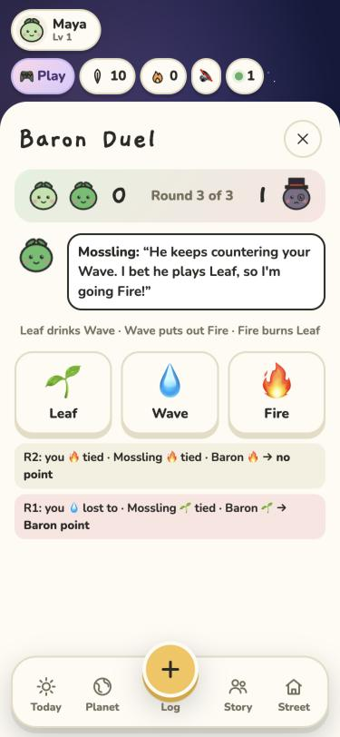
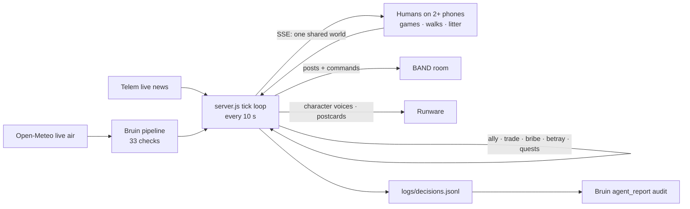
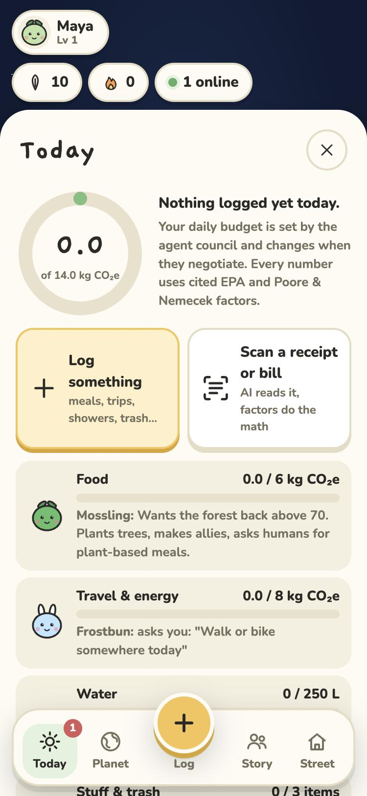
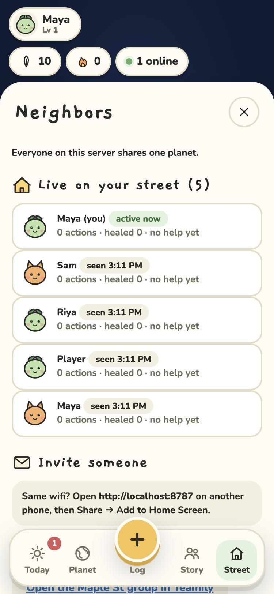

<div align="center">

# 🌍 Impact

### Heal the planet together

**Five AI characters live on a shared 3D planet that runs on your real day.<br>They argue, they get bribed, and they need *you* to save them.**

[**🌐 Website + 3D slides**](https://arushish5-cyber.github.io/impact/) · [**🎞️ Slides**](https://arushish5-cyber.github.io/impact/#slides) · [**🎬 Demo video**](https://arushish5-cyber.github.io/impact/#video) · [**▶ Run it**](#run-it)


  

*Agents for Impact Hackathon · Nov 23, 2026 · AWS Loft*

</div>

---

## 🎯 Judge it in 60 seconds

1. **Open the app** and pick a buddy. Five characters are already walking the planet and acting every 10 seconds.
2. **Tap 🎮 GAMES**: play **Trash Dash** with Ripplet (an AI teammate) or the **Baron Duel** (the Baron learns your moves; your teammate reads his pattern out loud).
3. **Wait for a showdown**: the Smog Baron bribes Sunfox live. Outbid him with seeds before Sunfox decides, on every phone at once.
4. **Turn on 🔊**: every character talks with its own Runware voice.
5. **Story → Every decision**: each move shows *why*, *the data it used* and *its source* (Bruin air data, Telem news).

## 🧠 What it is

Impact is a co-op 3D planet. **Five AI agents with their own goals** live on it and act every 10 seconds, even when nobody is playing. **Two or more humans** join from their phones and share the same world. The agents' choices are driven by **live air-quality data from a Bruin pipeline**, **today's real news from Telem**, and the humans' **real actions**: walking instead of driving, binning litter, refusing plastic. An **agent council** renegotiates the street's daily budget every few minutes. Every decision is logged with *why*, *the data it used* and *its source*, and Bruin audits the agents afterwards.

| | Agent | Wants | Voice (Runware) |
|---|---|---|---|
| 🌱 | **Mossling** | the forest back above 70; plants trees, makes allies | Pixie |
| 💧 | **Ripplet** | a clean ocean; your Trash Dash teammate | Sarah |
| ❄️ | **Frostbun** | the ice safe; asks you to walk one trip | Olivia |
| 🦊 | **Sunfox** | seeds, from whoever pays most (the Baron keeps trying) | Timothy |
| 🎩 | **Smog Baron** | the planet below 30; targets zones nobody watches | Hades |



## Screenshots

| Planet | Today | Story | Street | Baron Duel |
|---|---|---|---|---|
|  |  |  |  |  |

## Run it

Needs Node 20.12+ (for `--env-file-if-exists`). No npm install: the server has zero dependencies.

```bash
npm start            # http://localhost:8787 ; phones on the same wifi use the LAN URL printed in the console
npm run demo         # agents tick every 3 s (for the video)
npm run all          # bruin run pipeline, then start the server
npm test             # engine checks (seeds, decision log, quests, learning)
```

- Second player on the same laptop: open `http://localhost:8787/?p=2` in another window.
- No server? The PWA still opens from cache and the same agent engine runs in the browser (offline, single player).
- Phones: open the LAN URL, then Share → Add to Home Screen (it is a PWA with a manifest and service worker).

## Hackathon requirements, and where to see them

| Requirement | Where |
|---|---|
| Characters with a visual identity | Five drawn characters (faces, ears, the Baron's top hat) walking on a WebGL low-poly planet, and as cards in the Agents panel |
| Visual output: movement and actions on screen | Agents walk between zones, speech bubbles show each action, zones visibly heal (green, trees grow) or sicken (grey, smog puffs, space junk) |
| ≥ 3 agents with distinct goals | Mossling (forest ≥ 70), Ripplet (ocean), Frostbun (ice), Sunfox (get rich in seeds), Smog Baron (planet below 30) |
| Agents interact with each other | Alliances, trades, the Baron bribes Sunfox, Sunfox betrays or refuses (and can leak intel), guardians confront the Baron and help each other |
| ≥ 2 humans | Everyone on the server shares one world over Server-Sent Events. Neighbors tab → "Live on your street" |
| Visible decision log | Agents panel → Decision log: action, **why**, **data used**, **sources** (Bruin, Telem), alternatives considered. Also `logs/decisions.jsonl` |
| Acts on its own schedule; world changes while you're away | Server tick loop runs without players; after a restart it replays missed ticks ("caught up N missed ticks"); the app shows "While you were away…" |
| Two runs, different outcomes | Agents panel → **Run it twice** (seed 42 vs 7: instant 120-tick simulations with health curves, betrayals and alliances) |
| Booster: 3D | Three.js planet, agents, smog, orbiting debris |
| Booster: learns between runs | `data/agent_memory.json`: per-agent action → reward running averages bias the next run ("remembers run 2: prefers to tend") |
| Real-world impact | **Today** tab: your carbon ledger vs a budget the council sets; log trips, energy, showers, trash, bills; guardians give missions from your real log ("Travel and energy are at 10.1 kg today. You drove 40 km."). The agents never judge what people eat. |
| Booster: voice | Each character speaks with its own **Runware** text-to-speech voice (🔊 in the top bar, 🔊 Hear on every character card); the browser's speech is only a fallback |

## The carbon ledger and the council

- **Log it** (center tab): tap what you did. Each line is computed from `public/factors.js`, where every number is cited: Poore & Nemecek (2018) via Our World in Data for food; US EPA for driving (404 g CO2/mile), gasoline (8,887 g/gal), electricity (0.394 kg/kWh), natural gas, and WaterSense for showers. Assumptions (like a 150 g portion) are shown next to the number.
- **Scan a receipt or bill**: Gemini (or OpenAI) reads the photo and only *extracts* line items into a fixed JSON schema. It never produces a number: the server computes footprints from the same cited factors, and unknown items are shown as "not counted", never guessed.
- The server ignores any numbers the client sends; it recomputes every line. Each line goes to `logs/ledger.jsonl` with its factor key and amount.
- **Missions from your log**: when you go over today's budget in a category, its agent reacts on the next tick (Frostbun: travel and energy, Ripplet: water, Sunfox: stuff; Mossling asks for park clean-ups). Logging a walk completes Frostbun's mission.
- **Council** (every 12 ticks): the agents read the street's real logs, and an under-budget guardian can give part of its budget to an over-budget one (if it trusts it). The Smog Baron lobbies for a "Black Friday flash sale"; Sunfox casts the deciding vote based on its greed and trust. The council also learns which nudges each person actually follows.

## The game: real life earns seeds, seeds win showdowns

Real actions (a Litter Hunt, a walk instead of a drive, a mission) earn **seeds**. Seeds are how you play against the agents, live on the planet screen, together with everyone on your street:
- **Bribe showdown:** when the Smog Baron bribes Sunfox, a card pops up on every phone and Sunfox *thinks for 2 ticks*. Players outbid the Baron with seeds; the outbid goes straight into Sunfox's refuse/betray scores. Then everyone sees the result: *"Sunfox stayed loyal!"* or *"Sunfox BETRAYED everyone!"*
- **Shield:** the Baron's next target is shown live. Seeds put a shield on that zone: it blocks up to 80% of his next attack and makes him less likely to pick it.
- **Tap a character** on the planet to see its mood and what it wants, give it seeds, or ask it for a personal mission.
- **Story tab:** the run as a short feed of big moments (with faces); the full decision log with reasons and sources sits under a fold for judges.

## Games (🎮 GAMES on the planet)

- **Trash Dash** (real-time arcade, co-op): you and Ripplet catch falling litter while the Smog Baron flies overhead dropping smog bombs. Ripplet is an agent: it chases the best item on its half, dodges bombs and calls out your combos. Golden seeds, x2/x3 combos, 3 hearts, 45 seconds. Your score heals the ocean for everyone.
- **Baron Duel** (co-op, AI teammate): Leaf drinks Wave, Wave puts out Fire, Fire burns Leaf. You and the guardian of the weakest zone play together against the Smog Baron. The Baron is an agent that learns: he counters the move you play most. Your teammate reads his pattern out loud ("He keeps countering your Wave, so I'm going Fire!") and picks its own move. Best of 3; a win heals that zone for everyone.
- **Smog Pop**: pop the Baron's smog blob in 20 seconds.
- **Litter Hunt** and **Ask for a mission**: the real-life games that earn seeds.

The Games screen and the Street screen show a live sponsor strip: a dot turns green only after that sponsor's real call worked.

## Litter Hunt and why people come back

- **Litter Hunt** (Go! tab, Today tab, or Ripplet's "Do a 150 m Litter Hunt" mission): walk at least 150 m while the phone counts distance with GPS, tap **Binned one** and snap a photo for each piece of litter. The server computes the reward (client numbers are ignored): Ocean +1, plus up to +2 for the walk, plus 0.8 per piece with a photo. It completes Ripplet's mission and puts you on the street's **Top Litter Hunters** board. Location never leaves the phone, only the distance. GPS needs a secure (https) link; on plain http the hunt runs in honor mode and the walk counts less.
- **Daily streak 🔥**: any real action counts for the day. On streak days 2, 3, 5, 7, 14 and 30 a guardian cheers you in the log and Forest, Ocean and Ice each get +1.
- **The world keeps going**: agents act while you're away and the app shows "While you were away…", so there's always something new.

## How the agents decide (`public/agents-engine.js`, shared by server and browser)

Every tick, each agent lists its options and scores them:

**goal gap × live data signal (Bruin) × relationships (trust matrix) + seeded personality + learned bias + a little seeded noise**

It picks the top option and the effect changes the shared world. The log records the runner-ups it rejected. Examples:

- Frostbun's urgency rises on warm days (`heat` from Bruin); Mossling's when forest PM2.5 is high (`smog_pressure`).
- The Smog Baron targets zones that are weak, smoggy in real life, and **ignored by humans** (real actions add "attention").
- Sunfox weighs the bribe against how much the guardians trust it. Betraying steals seeds and leaks the weakest zone to the Baron; refusing raises trust.
- Guardians post **personalized quests** from each player's profile quiz ("You drive most days. One trip on foot cools my ice"). Completing one in real life gives a bonus.

## Bruin (`pipeline/`)

| Asset | What it does | Checks |
|---|---|---|
| `raw.air_live` (Python) | Live hourly PM2.5, temperature, humidity from Open-Meteo for Griffith Park, Mt. Baldy, Downtown LA, Santa Monica Bay. Falls back to a labeled snapshot per place if a fetch fails | |
| `staging.stg_air_daily` (SQL) | Daily averages per zone | not_null, accepted_values, non_negative, 3 custom (PM2.5 0–500, temp −30–55 °C, all 4 zones present) |
| `marts.daily_spawn` (SQL) | What agents read each tick: `smog_pressure`, `heat`, `spawn_score` (+ space) | not_null, unique, non_negative, custom "5 zones" |
| `raw.agent_decisions` (Python) | Loads `logs/decisions.jsonl`, written live by the server | |
| `marts.agent_report` (SQL) | Audits every agent: allies, trades, betrayals and bribes, fights, quests, decisions grounded in Bruin data | not_null, unique, positive, custom "no agent acts without a reason" |
| `raw.emission_factors` (seed CSV) | The cited factor table (EPA, Poore & Nemecek), same numbers as the app | not_null, unique, non_negative |
| `raw.ledger` (Python) | Every real log line from `logs/ledger.jsonl` (factor key + amount) | |
| `marts.footprint_daily` (SQL) | **Recomputes** everyone's footprint per person per day from the factor table (Today tab: "Source: Bruin footprint_daily") | not_null, non_negative, 3 custom: every line has a source, every line maps to a cited factor, **the app's CO2 math matches Bruin's** |
| `export.game_data` (SQL) | Writes `data/daily_spawn.csv`, `data/agent_report.csv`, `data/footprint_daily.csv`; the server hot-reloads them | |

```bash
bruin validate pipeline   # ✓ 9 assets, no issues
bruin run pipeline        # ✓ 9 assets, 33 quality checks passed
```

After a run, the Agents log cites `Bruin · daily_spawn <date>` on every agent decision, **Run report** says `Source: Bruin agent_report`, and Today's history says `Source: Bruin footprint_daily`. Bruin isn't only a loader here: it computes everyone's carbon ledger, checks the app's math, and holds the AI agents accountable.

## Sponsors: honest status

The app's **Me → How Impact works** shows live status from `/api/health`. A sponsor turns green only after a real call succeeds on the server.

| Sponsor | Use in Impact | Status |
|---|---|---|
| **Bruin** | Recomputes everyone's carbon ledger, feeds the agents live air data, audits every decision | ✅ **used**: validate + run pass (9 assets, 33 checks), live Open-Meteo data, server hot-reloads it |
| **BAND** | The street's group chat is a real BAND room, both ways. **Out:** alliances, bribes, betrayals, missions, council meetings and run endings are posted with the agent's reason (max 1 per agent per minute). **In:** humans @mention Impact World with `status`, `rally ocean`, `budget`, `report`; a rally changes the shared planet for every player and is logged with source "BAND room" | ✅ **used: verified live**. Agent "Impact World" posts into the room over REST; the live WebSocket (Phoenix V2) is connected for incoming commands; startup backlog drain; claim → reply → processed |
| **Telem** | Today's real news per zone changes what the agents do: alarming news (smoke, beach closures, smog alerts, low snowpack) raises that zone's guardian urgency and draws the Smog Baron toward it; the log cites the article with a link; Feed shows "Live · via Telem" reels | ✅ **used: verified live**. Example from today: forest news *"New wildfire reported in Los Angeles County on Nov. 23"* (sacbee.com) raised Mossling's urgency; only dated articles from the last 14 days are used, newest first |
| **Runware** | **Character voices:** each agent speaks with its own Runware text-to-speech voice (Inworld TTS-2: Mossling = Pixie, Ripplet = Sarah, Frostbun = Olivia, Sunfox = Timothy, Smog Baron = Hades) in showdowns, the Baron Duel, cheers and the 🔊 button on every character card. **Story postcards:** every run ends with a storybook postcard of the final planet (Feed + BAND room), plus "Make my world postcard" on demand. Images stay on the side, never the main game view. | ✅ **used: verified with real calls**. Voice lines ≈ $0.002 each, postcards ≈ $0.006 each, cached per line / world state |
| Glasser | Drop-off places in Bin Buddy | not used: we focused on the sponsors whose tools the game needs; adapter kept in `sponsors/glasser.js`, hidden in the app |
| AI: Gemini (OpenAI optional) | Receipt/bill scanner (vision, extraction only, structured JSON) + one-line agent voices (max 1 per 30 s) | ✅ **used: Gemini verified with a real call**. A test grocery receipt came back as 6 correct items (paper towels, tax and totals skipped); footprints computed from the cited factors. The server picks the newest Flash model the key can actually use. OpenAI is wired as an automatic backup (same request retries on OpenAI if Gemini fails), but **not used today: the OpenAI account has no API credits** (`credit_balance_exhausted`) |
| Lingcode | Wrap the PWA as an app | not used yet |
| Teamily | "Maple St" street group for humans + a role agent (link in Neighbors) | event comms |
| AdaL | Demo video | — |

To turn one on: copy `.env.example` to `.env`, add the key, and run `npm start`. If one still fails, this table will say why. Nothing is faked.

## Data honesty
- Air data is live from Open-Meteo through Bruin (`source` column says `open-meteo (live)`), or a labeled snapshot.
- Footprint numbers in the profile are very rough estimates from published averages.
- Photo proof stays on the device. It is not uploaded or verified by AI.
- Players and neighbors shown are real players on the server (no fake sample neighbors).

## Files
```
server.js                 zero-dependency server: SSE, tick loop + catch-up, decisions.jsonl, API
public/agents-engine.js   the five agents (shared by server and browser)
public/factors.js         cited emission factors (shared by server and browser)
public/app.js             PWA UI · public/globe.js 3D planet · public/faces.js characters
pipeline/                 Bruin assets  ·  .bruin.yml (DuckDB at data/impact.duckdb)
sponsors/                 Telem, BAND, Runware, Glasser, Gemini/OpenAI adapters (honest health)
test/engine.test.js       engine checks
```
